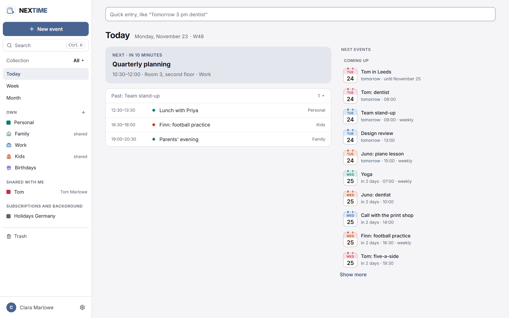
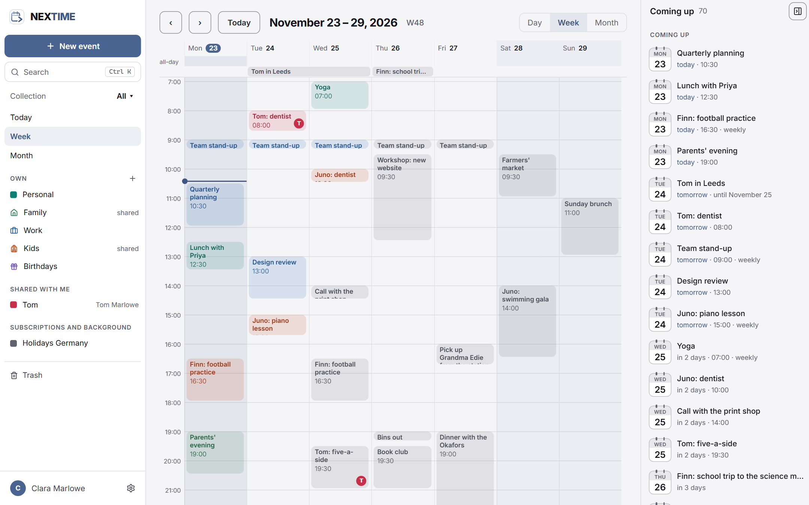
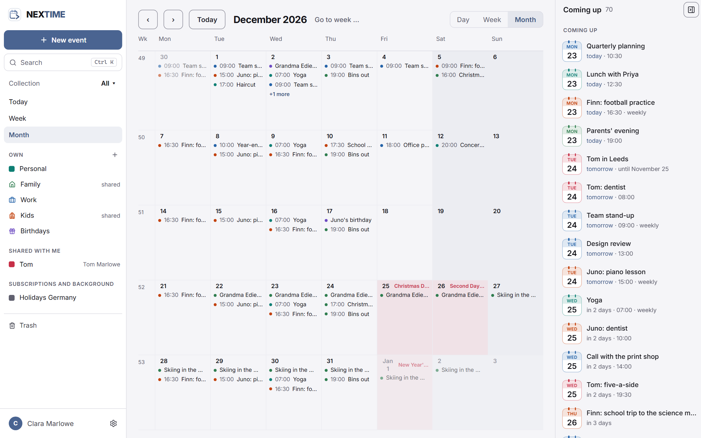
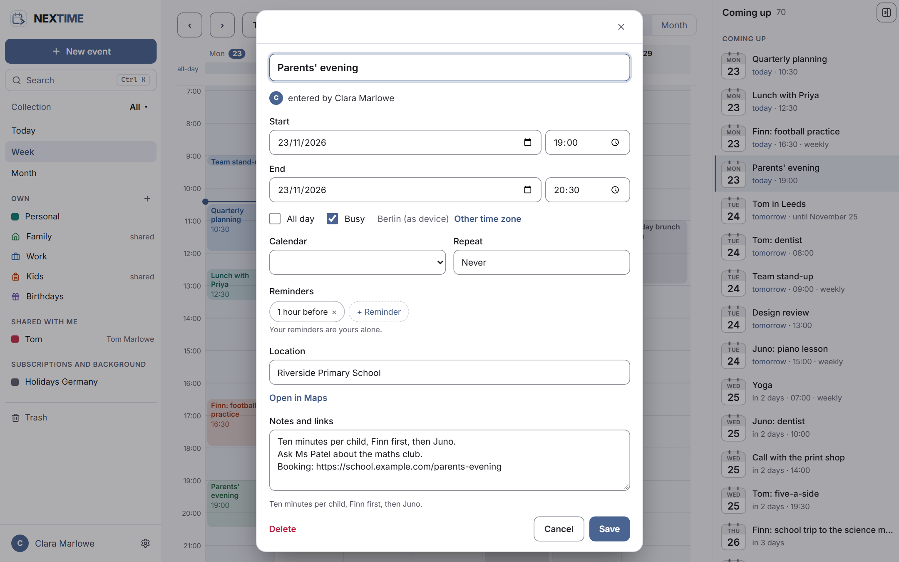
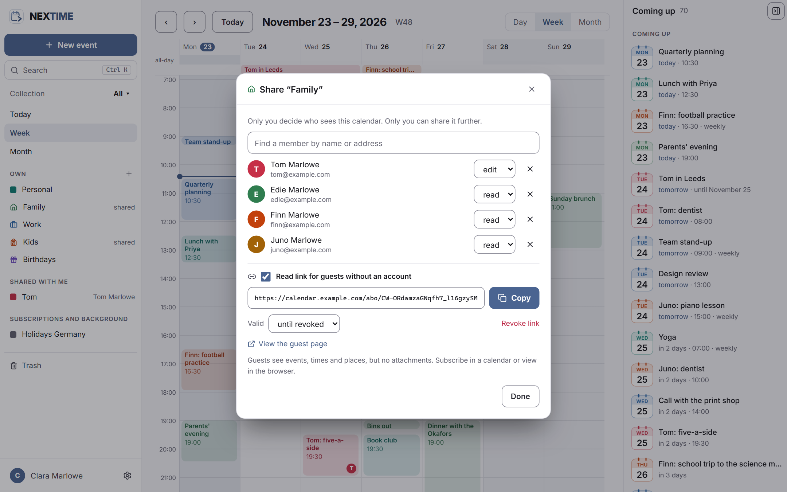
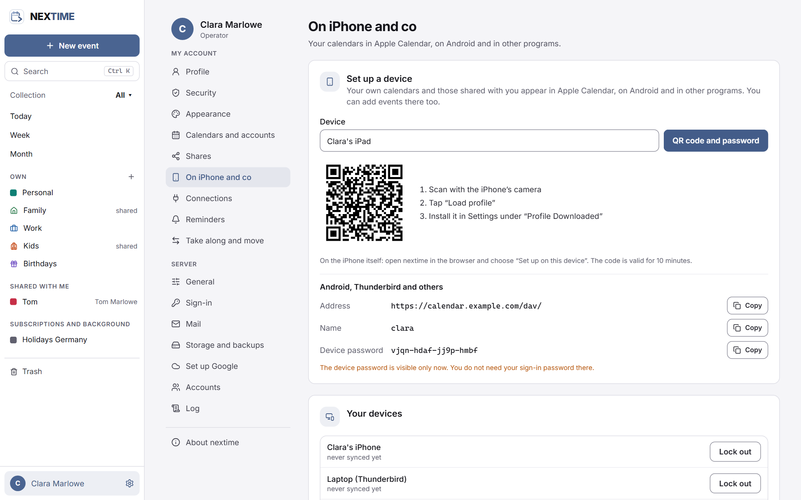
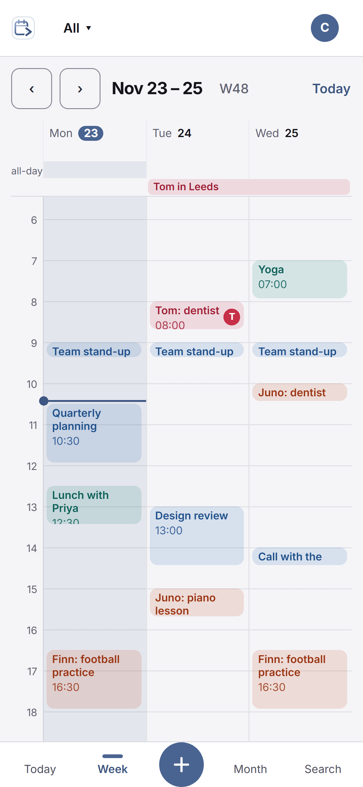

# nextime

A self-hosted calendar for families and small groups: your own calendars on your own server, in the browser and, later,
on iPhone and Android through CalDAV.

> **Early days.** Everything below is built and in daily use; this is an early release, so keep a backup and open an
> issue when something is wrong. The native app for iPhone and iPad comes separately; until then phones connect through CalDAV.



*Today, across every calendar: what comes next and how soon, the rest of the day, and the next events of the days
after. Quick entry at the top understands a line like "Tomorrow 3 pm dentist". On the left the views, own calendars,
calendars shared with you, and public holidays in the background.*

## Screenshots



*The week, with an event from a calendar shared by someone else carrying their initial. Events move by dragging;
the column "Coming up" on the right folds away.*



*The month. Built-in public holidays stand out, and an event over several days shows on each of them.*



*An event opens over the page: times and time zone, busy or free, calendar and repeat, reminders that are yours alone,
a place with a link to a map, notes with links.*



*Share a calendar with members of the server, each with a right of their own, or with guests through a read link they
can subscribe to.*

<p>
  
  
</p>

*A device gets its own password: the iPhone scans a QR code and loads a profile, Android and Thunderbird take the
address. On a phone the week shows three days, and nextime installs from the browser as an app.*

## What is there

- **One container.** FastAPI and SQLite, the interface built in. The first account is the operator; it needs the
  setup code from the log or the one you set.
- **Accounts.** Invitations, roles, blocking, deleting with 30 days to bring an account back, a second factor (TOTP),
  sign-in through OpenID Connect providers such as authentik or Microsoft Entra ID.
- **Operation.** Daily backups at 03:00 in the server's time zone (14 kept, both adjustable), restore with a check of
  what comes, changes and goes, a log with four levels, limits and switches for the whole server, a hint when nextime
  is not reached over HTTPS.
- **Calendars and events.** Own calendars with eleven colors or one of your own and a symbol, hidden or shown, in an
  order of one's own; events with whole days, time zones, busy or free, notes with links and "Join" for video
  meetings; series daily, weekly, monthly or yearly with exceptions, stored as iCalendar objects.
- **Calendar account.** A CalDAV server under `/dav/` for Apple Calendar, DAVx5, Thunderbird: a password per device,
  a QR code and a profile for the iPhone, each device locked out on its own. Needs HTTPS.
- **Ready for the iPhone and iPad app.** Pair a device with a QR code (valid 10 minutes) or by signing in from the
  app, see and disconnect devices, sync every event offline with changes taken exactly once, both versions after a
  conflict, a silent nudge and notifications of shared calendars through a push relay that sees only ciphertext. The
  app itself comes separately.
- **Other sources.** iCloud (with an app-specific password), Google (with the operator's own Google Cloud client, or
  read only through a calendar's secret address) and other CalDAV servers such as Nextcloud, read and written, synced
  every minute; changes made while a source is away wait and go out later. Subscriptions to calendar links, fetched
  hourly. Public and school holidays of Germany, Austria and Switzerland built in (no service asked). Invitations from
  iCloud and Google answered from nextime. Access data is stored encrypted and never shown again.
- **Sharing.** Own calendars shared with other accounts (see busy only, read, change) and with guests through a
  read-only link; the picture of whoever entered an event in a shared calendar; notifications by web push when others
  change something.
- **Everyday.** Reminders per person and device, a place with address suggestions and a small map, attachments, quick
  entry in one line with day and time, defaults for new events per calendar (an all-day yearly birthday with a
  reminder the day before), a search over everything, a trash with undo, public holidays standing out in the views.
- **Sister apps.** Due tasks from [nextasks](https://github.com/DerKezorm/nextasks) and deadlines from
  [nexpaper](https://github.com/DerKezorm/nexpaper) in the calendar, each connected per person with a key of that app.
- **For programs.** A REST API with keys per person and an MCP server for AI assistants, the operator decides who may
  use them, each key with its own rights.
- **Languages and appearance.** German and English, more as files from the operator; light, dark or like the device;
  the first day of the week, ISO week numbers, 12 or 24 hours and the time zone per account.
- **Phone and installed web app.** A bar at the bottom below 1024 px, the week as three days on a phone; installable
  from the browser with its own symbol. Without a connection the installed app keeps showing the next four weeks to
  read and search (kept in the browser, gone when signing out); adding events needs a connection.
- **Take along and move.** Every calendar as an ICS file, all of them as a ZIP with the attachments beside; ICS files
  loaded into an own calendar with a preview and without duplicates; a calendar from iCloud or Google moved into an own
  one, while iCloud and Google stay untouched.

## Start

```yaml
services:
  nextime:
    image: ghcr.io/derkezorm/nextime:latest
    container_name: nextime
    restart: unless-stopped
    ports:
      - "8585:8000"
    volumes:
      - ./data:/data
    environment:
      PUID: 1000
      PGID: 1000
      TZ: Europe/Berlin
```

Then `docker compose up -d`. Images for `linux/amd64` and `linux/arm64` are on the GitHub Container Registry and on
Docker Hub (`derkezorm/nextime`), one tag per release (`0.1.0`) and `latest`. The [docker-compose.yml](docker-compose.yml)
in this repository has the same service with every option explained; it builds from source with
`docker compose up -d --build`.

Open `http://<your-host>:8585` and create the first account: it becomes the operator and needs the setup code from the
log (`docker logs nextime`). Calendars on iPhones and Android connect only over HTTPS: put nextime behind a reverse
proxy that ends TLS and name it in `NEXTIME_TRUSTED_PROXIES`.

## Settings

| Variable | Meaning |
|---|---|
| `NEXTIME_DATA_DIR` | Database, attachments, backups, logs, added languages. In the container `/data`. A local disk, never a network share. |
| `NEXTIME_SETUP_TOKEN` | The code the first account needs. Without it nextime makes one at every start until it is set up and writes it to the log. |
| `NEXTIME_PUBLIC_URL` | The address people reach nextime under (invitation links, the providers' redirect). Can also be set in the interface. |
| `NEXTIME_TRUSTED_PROXIES` | Addresses or networks of reverse proxies whose `X-Forwarded-For` and `X-Forwarded-Proto` count. |
| `NEXTIME_OPERATOR_NETWORKS` | Networks the operator's settings may be changed from. Empty: from anywhere. |
| `NEXTIME_SECRET_KEY` | The key for the server's own secrets. Empty: a random one in the data folder. |
| `NEXTIME_LOG_LEVEL` | Overrides the log level set in the interface: `quiet`, `normal`, `detailed`, `trace`. |
| `NEXTIME_DAV_ALLOW_HTTP` | `true` lets the calendar account answer over plain HTTP too. For development only: off, devices connect over HTTPS only. |
| `NEXTIME_COOKIE_SUFFIX` | Keeps the sign-ins of two instances on one host apart. |
| `NEXTIME_PLACES_URL` | The address search behind the suggestions in the place field, a [Photon](https://github.com/komoot/photon) service. Empty: the free one at photon.komoot.io. nextime asks it, not the browser, and sends only the typed place. The operator can switch suggestions and maps off. |
| `NEXTIME_TILES_URL` | Where the small map of a place is drawn from, with `{z}/{x}/{y}` in it. Empty: the tiles of OpenStreetMap. |
| `NEXTIME_PUSH_RELAY` | The push relay that wakes the nextime app on iPhone and iPad when something changed (only the device's ticket and an encrypted note go there, never the content). Empty: nothing goes out. Default `https://push.nexapps.dev`. |
| `NEXTIME_MEDIA_MEMORY_MB` | Memory of the process that reads pictures and PDFs of attachments for their previews (1024 MB from the start). |
| `TZ` | The server's time zone; the daily backup runs in it. |
| `PUID`, `PGID` | Who owns the files in the data folder. |

A variable with a wrong value stops the start with a line in the log that names it and the values it takes.

## Development

```sh
cd backend && python -m venv .venv && .venv/bin/pip install -r requirements-dev.txt
NEXTIME_DATA_DIR=../data .venv/bin/uvicorn app.main:app --port 8585
cd frontend && npm ci && npm run dev   # http://localhost:5585
```

Checks: `pytest -q -n 4` and `ruff check .` in `backend`, `npx vitest run`, `npm run lint` and `npm run build` in
`frontend`.

## Licence

AGPL-3.0, see `LICENSE`. What nextime ships or depends on, with its licence, is listed in
[THIRD-PARTY.md](THIRD-PARTY.md).
